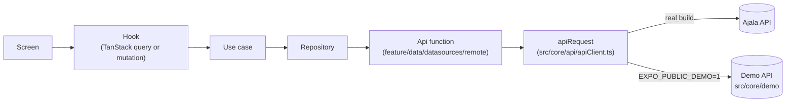

# Backend guide: how the app talks to the API

This guide explains how Ajala reads and writes data on the server. It follows one request from a tap to the
server and back, and then covers each part on its own. It takes about 20 minutes to read.

The code is the source of truth. The API contract lives in
[ajala-api-users-common.md](api/ajala-api-users-common.md) (the "spec"), and this guide links to it instead of
repeating it. Open requests to the backend team live in [backend-requests.md](api/backend-requests.md). Items
from that file appear here as **A1**, **B2** and so on.

---

## 1. The big picture

Every call goes through the same six steps. Each step lives in its own file and knows only about the step
below it.



| Step | What it does | Example file |
| --- | --- | --- |
| Screen | Draws state and calls the hook. Never sees HTTP. | [PostDetailScreen.tsx](../src/features/post-detail/presentation/screens/PostDetailScreen.tsx) |
| Hook | Owns the cache: `useQuery` for reads, `useMutation` for writes. | [usePostDetail.ts](../src/features/post-detail/presentation/hooks/usePostDetail.ts) |
| Use case | One action in plain words, for example "join a post". | [PostDetailUseCases.ts](../src/features/post-detail/domain/usecases/PostDetailUseCases.ts) |
| Repository | Calls the API function, turns DTOs into entities, and turns `ApiError` into the feature's own error. | [PostDetailRepositoryImpl.ts](../src/features/post-detail/data/repositories/PostDetailRepositoryImpl.ts) |
| Api function | One function per endpoint: method, path and body. | [postDetailApi.ts](../src/features/post-detail/data/datasources/remote/postDetailApi.ts) |
| `apiRequest` | The only place that calls `fetch`. | [apiClient.ts](../src/core/api/apiClient.ts) |

Each feature has a **module** file (for example
[postDetailModule.ts](../src/features/post-detail/postDetailModule.ts)) that builds its repository and use
cases. A small hook such as `usePostDetailUseCases()` builds the module with auth's signed-in `request`
function, so every call carries the person's token.

### Worked example: tapping "Join" on a post

The person opens a post and taps **Join**.

**1. The screen** calls `vm.join()` from `usePostDetail(postId)`.

**2. The hook** checks for a booking link first. If the post has an `externalUrl`, it opens the link and sends
`POST /posts/{id}/link-click`. Then it runs the `rsvp` mutation with `'join'`.

**3. Optimistic update.** Before any request goes out, `onMutate` saves the current post and draws the
expected result into the `['postDetail', 'post', id]` cache (`expectJoin` in
[postDetailRules.ts](../src/features/post-detail/domain/rules/postDetailRules.ts)):

- a private post shows **Requested**;
- a full post shows **Waitlisted**;
- anything else shows **Going**, and the going count goes up by one.

**4. Down the layers.** `useCases.join(postId)` → `repo.join(postId)` → `api.join(postId)`. The last one sends:

```ts
// src/features/post-detail/data/datasources/remote/postDetailApi.ts
join: (id) => request<RsvpStateResponseDto>({ method: 'POST', path: `${post(id)}/rsvp` }),
```

`request` is auth's `authorizedRequest`. It adds the bearer token (and refreshes it when needed, see
[section 3](#3-signing-in-and-staying-signed-in)), and then calls `apiRequest`.

**5. On the wire:**

```http
POST https://dev-api.ajalatrvl.com/api/v1/posts/7f0c…/rsvp
Authorization: Bearer eyJhbGciOi…
Accept: application/json
```

```json
200 OK
{ "state": "going", "goingCount": 13, "capacity": 20, "waitlistPosition": null }
```

**6. Back up.** The mapper turns the DTO into an `RsvpResult`. `onSuccess` writes the server's answer over
the guess (`withRsvp`). `onSettled` refreshes the "Who's going" list.

**7. If it fails,** `onError` puts the saved post back, and the page is fetched again. The repository maps
the API's `code` to a `PostDetailErrorCode`, and the screen shows the matching line from
[copy.ts](../src/features/post-detail/presentation/copy.ts):

| API answer | Error code | What the person sees |
| --- | --- | --- |
| 409 `POST_FULL` | `postFull` | "It just filled up. Try the waiting list, or explore other activities." |
| 409 `POST_STARTED` | `postStarted` | "It has already started, so new people can't join." |
| 409 `POST_CANCELLED` | `postCancelled` | "The host cancelled it." |
| 409 `EXTERNAL_BOOKING` | `externalBooking` | "Book this one through its link." |
| 409 `CONFLICT` / 403 | `notAllowed` | "You can't do that on this post." (own post, or the host declined you) |
| 404 / 410 | `notFound` | "This post isn't available any more." |
| 429 | `rateLimited` | "Too many tries. Wait a moment and try again." |
| no network / timeout | `network` | "You seem to be offline. Check your connection and try again." |
| 401 after a refresh | `sessionExpired` | "Your session ended. Sign in again to continue." |

The mini card on the Explore map does the same thing through
[useJoinPost.ts](../src/features/explore/presentation/hooks/useJoinPost.ts), with its own cache key
`['explore', 'post', id]`.

---

## 2. The API client

All HTTP goes through `apiRequest<T>()` in [apiClient.ts](../src/core/api/apiClient.ts).

### Base URL and environment variables

| Variable | What it does | Where it is read |
| --- | --- | --- |
| `EXPO_PUBLIC_API_URL` | The server. Default `https://dev-api.ajalatrvl.com`. Use `http://localhost:3000` for a local server. | [apiConfig.ts](../src/core/api/apiConfig.ts) |
| `EXPO_PUBLIC_DEMO` | `1` swaps the server for the demo API ([section 6](#6-demo-mode)). | [demoMode.ts](../src/core/demo/demoMode.ts) |
| `EXPO_PUBLIC_GOOGLE_WEB_CLIENT_ID`, `EXPO_PUBLIC_GOOGLE_IOS_CLIENT_ID` | Google sign-in. Without them the Google button says "not available". | [googleIdentity.ts](../src/features/auth/data/datasources/native/googleIdentity.ts) |
| `EXPO_PUBLIC_IOS_APP_STORE_ID` | The store link on the forced-update screen. | `app.config.js` |

Copy [.env.example](../.env.example) to `.env` to set them. These values are built into the app, so never
put a secret in them. They are read once at startup: restart Metro after a change.

Every path starts with `/api/v1`. Each api file writes it as `const V1 = '/api/v1'`.

### What one request looks like

```ts
await apiRequest<MeDto>({
  method: 'GET',
  path: '/api/v1/me',
  accessToken,                      // optional: adds "Authorization: Bearer …"
  headers: { 'X-Client-Location': '6.428,3.422' }, // optional extra headers
  retry: true,                      // GETs only; true by default
});
```

- **JSON.** A plain object `body` is sent as JSON with `Content-Type: application/json`.
- **Multipart.** A `FormData` body is sent as it is, and `fetch` writes the `Content-Type` with its boundary.
  Uploads use this: the avatar (`file`), post photos (`images`, repeated), and chat messages.
- **Empty answers.** A 204, or a body of length 0, returns `null`. Several auth calls answer 202 or 204.
- **Timeout.** Every attempt gives up after **15 seconds** and fails with `TIMEOUT`.
- **Retries.** A `GET` that fails with `NETWORK`, `INTERNAL` (500) or `SERVICE_UNAVAILABLE` (503) is tried
  again after 400 ms and then 1,200 ms. Other methods are never retried, because a `POST` may already have
  landed. A timeout is not retried either. TanStack Query's own retry is off
  ([queryClient.ts](../src/core/api/queryClient/queryClient.ts)), so there is only one layer of retries.

### The location header

Some reads send `X-Client-Location: <lat>,<lng>`, rounded to 3 decimals (about 100 m). The server uses it to
pick the city and to work out distances. `getClientLocationHeader()` in
[deviceLocation.ts](../src/core/location/deviceLocation.ts) builds it. It returns `null` (no header) when
location is off.

These calls send it: the feed, map pins, a post (on the post page and the map card), post search, and the
profile lists (`/me/saved`, `/me/rsvps`, `/users/{id}/posts` and the others). A demo build always reports
Victoria Island, Lagos.

### How errors become `ApiError`

Every failure becomes an [ApiError](../src/core/api/ApiError.ts), whatever went wrong:

```ts
class ApiError {
  code: ApiErrorCode;          // 'POST_FULL', 'UNAUTHORIZED', 'NETWORK', …
  status: number | null;       // 409, 401, … (null when the server was never reached)
  message: string;             // for logs only; never branch on it
  fieldErrors: { field: string; message: string }[]; // with VALIDATION_FAILED
  details: Record<string, unknown> | null;           // e.g. { challengeId }
  requestId: string | null;    // quote it to the backend team
  retryAfterSeconds: number | null;                  // with 429
}
```

- The `code` comes from the server's error body. If the body is missing or unknown (a proxy's HTML page,
  say), the client picks a code from the status: 401 → `UNAUTHORIZED`, 409 → `CONFLICT`, 5xx → `INTERNAL`.
- Two codes come from the phone itself: `NETWORK` (offline, DNS, TLS) and `TIMEOUT`.
- On a 429, `retryAfterSeconds` comes from `Retry-After` or `x-ratelimit-reset`.
- **Branch on `code`, never on `message`.** The server's messages can change.
- In development builds, every failed call is logged to the console:
  `[api] POST /api/v1/posts/…/rsvp → 409 POST_FULL: … [requestId abc123]`. Request bodies are never logged.

`ApiError` stops at the repository. Each feature maps it to its own error type (`FeedError`, `ChatError`,
`AuthError` and so on), so screens deal only with friendly codes.

---

## 3. Signing in and staying signed in

All of this lives in the auth feature. Start with [authModule.ts](../src/features/auth/authModule.ts) and
[SessionUseCases.ts](../src/features/auth/domain/usecases/SessionUseCases.ts).

### Where tokens live

| Item | Where | Notes |
| --- | --- | --- |
| Access token, refresh token, `accessExpiresAt`, `sessionId`, `userId` | Secure store (iOS Keychain, Android encrypted storage), one JSON blob under `ajala.auth.session.v1` | [sessionStorage.ts](../src/features/auth/data/datasources/local/sessionStorage.ts). Never AsyncStorage. |
| Device id | AsyncStorage, `ajala.device.id.v1`, for example `ios-3b1f…` | [deviceIdentity.ts](../src/core/device/deviceIdentity.ts). A random id, made once per install. Not a secret. |

If the keychain fails to read, the app treats the person as signed out. It never crashes on startup.

Every auth call that creates a session also sends `deviceId` and `deviceName` (for example "Ada's iPhone"). The
server then replaces this phone's old session instead of adding a new one. The optional `deviceCheck` token is
not sent yet (**A5**).

### Lifetimes

- **Access token:** 15 minutes.
- **Refresh token:** single use. `POST /auth/refresh` returns a new pair and kills the old refresh token.
  Using a spent refresh token ends the whole session on the server.

### Making a signed-in call

Features never touch tokens. They call `authorizedRequest`, which is `apiRequest` wrapped in `withSession`:

```ts
// What every feature's api file receives as `request`
const page = await request<FeedPageDto>({ method: 'GET', path: '/api/v1/feed?type=meetup' });
```

`withSession` does this for each call:

1. Read the session from the secure store. None? The session is over.
2. If the access token expires in **under 60 seconds**, refresh first.
3. Send the call with the token.
4. On a **401**, refresh and retry the call **once**.
5. If the brand-new token also gets a 401, or the refresh itself is refused, clear the session and sign out.

### Single-flight refresh

Because a refresh token works only once, two refreshes at the same time would log the person out. So:

- Only **one** refresh runs at a time. Every caller waits for the same promise.
- Before refreshing, it reads the store again. If another call already rotated the tokens, it uses those.
- The new pair is saved **before** it is used, so a crash cannot leave a spent token in the store.
- If the person signed out while a refresh was in flight, the new pair is thrown away.
- If the refresh fails because the phone is offline, the session stays. The old token may still work.

There is only **one** `withSession` in the app. `AuthProvider`
([AuthContext.tsx](../src/features/auth/presentation/state/AuthContext.tsx)) builds the auth use cases once
and shares them.

The chat socket needs a token too. It calls `freshAccessToken()`, which is `withSession` returning the token.

### When the session ends by itself

If a refresh is refused, `onSessionEnded` runs. It clears the TanStack cache, forgets bookmark overrides
(`postSaves.reset()`), and sets the state to `signedOut`. The signed-in layout then sends the person to sign
in.

### Sign-out order

`useSignOut()` runs these steps, in this order:

1. **Tasks that need the session.** Today this is `POST /me/devices/unregister`, so the phone stops getting
   this account's pushes. The notifications feature registers it in
   [beforeSignOut.ts](../src/core/session/beforeSignOut.ts). All tasks together get at most **3 seconds**.
2. **`POST /auth/logout`**, through `withSession` (so an expired token is refreshed first).
3. **Clear the secure store.**
4. **`queryClient.clear()`** and `postSaves.reset()`, so nothing from this account is shown to the next one.

Errors in steps 1 and 2 are ignored. The person is always signed out on this phone, even offline.

### After sign-in: where to go

A login answers with tokens only. `useFinishSignIn` saves the session and then asks `GET /me`:

- `termsUpToDate: false` → the terms screen (`POST /me/terms/accept { version }`);
- `profileCompletedAt: null` → profile setup (**A1**: does gender count?);
- otherwise → the app.

A session restored at launch does the same check once (`useEntryCheck`). It waits at most 2.5 seconds, then
lets the person in and redirects later if needed.

The terms version always comes from `GET /app/config` ([appConfig.ts](../src/core/config/appConfig.ts),
cached for 5 minutes). If the server says the version is out of date, the app fetches the config again and
retries once.

### Email sign-in and its two 403s

`POST /auth/login { email, password, deviceId, deviceName }` can answer 403 for two different reasons:

| Code | Meaning | What the app does |
| --- | --- | --- |
| `EMAIL_NOT_VERIFIED` | The email was never confirmed. A code has been sent again. | Opens the sign-up code screen (`POST /auth/otp/verify`). |
| `STEP_UP_REQUIRED` | The password was right, but the server wants a code. | Shows a code screen, then **retries the same login** with `otpCode`. |

Email sign-up is `POST /auth/signup/email` (202), then `POST /auth/otp/verify { target, code, password }`,
which signs the person in.

### Password reset (a 6-digit code)

```text
POST /auth/password/forgot { email }          → 202 always (even for unknown emails)
POST /auth/password/verify { email, code }    → 200 { token }   (token lasts 15 minutes, single use)
POST /auth/password/reset  { token, newPassword } → 204, every device is signed out
```

- A wrong code is a 401. The **fifth** wrong code kills it, so the screen offers "send a new code".
- A 401 from `/reset` means the token expired or was used. The person must start again.
- After a reset the app clears its own session too (`endLocalSession`), and the flow ends on sign-in.

### Google, Apple and account linking

- **Apple:** a fresh nonce for each try. Apple gets its SHA-256 hash; the API gets the raw value with the
  identity token: `POST /auth/oauth/apple`. Apple's name is sent only the first time Apple gives it.
- **Google:** `POST /auth/oauth/google { idToken, nonce }`. The Google SDK in use cannot put the nonce into
  the token. If the API checks it, Google sign-in will be refused (see the note in
  [googleIdentity.ts](../src/features/auth/data/datasources/native/googleIdentity.ts)). The API also needs
  our client ids (**D2**).
- Both send the current `termsVersion` and the time zone.
- **Linking:** if the email already belongs to an account, the API answers **409 `ACCOUNT_LINK_REQUIRED`**
  with `details.challengeId` and emails a code. The link screen sends
  `POST /auth/oauth/link { challengeId, code }`, which attaches Google or Apple and signs the person in. There
  is no "resend": a failed code means tapping Google or Apple again.
- **Unlinking** is in Settings: `DELETE /me/identities/{provider}`. The last sign-in method cannot be removed
  (409 `LAST_SIGN_IN_METHOD`).

---

## 4. Reading and writing data

The app uses **TanStack Query** for every read and write. There is one client,
[queryClient.ts](../src/core/api/queryClient/queryClient.ts), with these defaults:

| Setting | Value | Why |
| --- | --- | --- |
| `staleTime` | 1 minute | A screen opened again within a minute shows the cache with no request. |
| `gcTime` | 10 minutes | How long an unused answer is kept in memory. |
| `refetchOnWindowFocus` | on | Coming back to the app counts as focus, so stale screens refresh. |
| `retry` | off | `apiRequest` already retries GETs. |

Nothing is stored on disk. The cache lives in memory and is cleared on sign-out.

### Query keys

Each feature keeps its keys in one `*Queries.ts` file, under its own first word, so features never clash.

| Feature | Keys (from the code) | File |
| --- | --- | --- |
| Shared | `['me']` (`GET /me`, profile's shape) | [queryClient.ts](../src/core/api/queryClient/queryClient.ts) |
| Home | `['feed', 'list', filter]`, `['feed', 'cities', q]`, `['popularCities']` | [feedQueries.ts](../src/features/home/presentation/state/feedQueries.ts) |
| Explore | `['mapPins', bbox, type, q]`, `['explore', 'post', id]`, `['explore', 'interests']`, `['feed', 'explore-meetups']`, `['searchPosts', words, interestIds, type]` | [exploreQueries.ts](../src/features/explore/presentation/state/exploreQueries.ts) |
| Post page | `['postDetail', 'post', id]`, `['postDetail', 'attendees', id, state]`, `['postDetail', 'comments', id]`, `['postDetail', 'comments', id, 'replies', commentId]`, `['postDetail', 'viewer']` | [postDetailQueries.ts](../src/features/post-detail/presentation/state/postDetailQueries.ts) |
| Create post | `['createPost', 'interests']`, `['createPost', 'cities', q]`, `['createPost', 'draft', id]` | [createPostQueries.ts](../src/features/create-post/presentation/state/createPostQueries.ts) |
| Trips | `['trips', 'going' \| 'hosted' \| 'requested' \| 'past']` | [tripsQueries.ts](../src/features/trips/presentation/state/tripsQueries.ts) |
| Profile | `['profile', 'person', id]`, `['profile', 'activity', id, tab]`, `['profile', 'rsvps', state]`, `['saved', filter]`, … | [profileQueries.ts](../src/features/profile/presentation/state/profileQueries.ts) |
| Settings | `['settings', 'account']`, `['settings', 'preferences']`, `['settings', 'sessions']`, … | [settingsQueries.ts](../src/features/settings/presentation/state/settingsQueries.ts) |
| Chat | `['chat', 'threads', filter, search]`, `['chat', 'thread', id]`, `['chat', 'messages', id]`, `['chat', 'typing', id]` | [chatQueries.ts](../src/features/chat/presentation/state/chatQueries.ts) |
| Notifications | `['notifications', unread]` | [notificationsQueries.ts](../src/features/notifications/presentation/state/notificationsQueries.ts) |
| Payment | `['subscription']` (5 minutes fresh) | [usePaymentUseCases.ts](../src/features/payment/presentation/state/usePaymentUseCases.ts) |

Keys start with a common word on purpose. `invalidateQueries({ queryKey: ['feed'] })` refreshes every key
that starts with `'feed'`.

### Lists with cursors

Long lists use `useInfiniteQuery`. The server returns `{ items, nextCursor }`. `nextCursor: null` means the
last page.

```ts
useInfiniteQuery({
  queryKey: notificationKeys.inbox(unread),
  queryFn: ({ pageParam }) => loadInbox(unread, pageParam), // sends ?cursor=… when not null
  initialPageParam: null as string | null,
  getNextPageParam: (last) => last.nextCursor,
});
```

Chat messages page backwards. The app sends `?before=<oldest message id held>`, and `nextCursor` is the next
`before`.

### Optimistic updates

For quick actions, the screen changes first and the server confirms later. Every one of them can roll back.

| Action | What changes at once | On success | On error |
| --- | --- | --- | --- |
| **Save (bookmark)** `POST`/`DELETE /posts/{id}/save` | `postSaves`, a small shared store, so **every** card of that post flips together ([useSavePost.ts](../src/shared/hooks/useSavePost.ts)) | Refresh every `['saved', …]` list | Put the old value back (also on 409 for a draft) |
| **RSVP** `POST`/`DELETE /posts/{id}/rsvp` | Button and going count on that page's cache | Write the server's `state` and counts | Restore, then refetch the post |
| **Comment** `POST /posts/{id}/comments` | A dimmed comment under the thread it answers ([useComments.ts](../src/features/post-detail/presentation/hooks/useComments.ts)) | Swap in the server's copy | Remove it. 409 `POST_CANCELLED` closes the composer |
| **Mark read** `POST /me/notifications/read` | Rows and badge in all `['notifications', …]` caches | Refetch | Restore all of them, then refetch |
| **Chat send** `POST /conversations/{id}/messages` | A dimmed message keyed by its `clientMsgId` | Swap in the server's message | Remove it; the composer keeps the text |
| **Settings toggles** `PATCH /me/settings`, `PATCH /me/analytics` | The switch | Keep the server's answer | Switch back |

**`clientMsgId`** is a UUID made when the message is first prepared. If a send fails and the person taps send
again with the same text and photos, the app reuses the **same** id. The server then knows it is a retry and
does not post the message twice.

The bookmark is shared code, but shared code may not import auth. So the signed-in layout passes
`authorizedRequest` down through [apiRequester.tsx](../src/shared/state/apiRequester.tsx). Outside the
signed-in area the bookmark fails like an expired session and rolls back.

### Refreshing after writes

| After | What is refreshed | Where |
| --- | --- | --- |
| Teleport or come home | `['feed']`, `['mapPins']`, `['searchPosts']` are **reset** (emptied, not just marked stale) so no old city flashes | [useTravelMove.ts](../src/features/home/presentation/hooks/useTravelMove.ts) |
| Publish a post | `['feed']`, `['explore']` | [useCreatePost.ts](../src/features/create-post/presentation/hooks/useCreatePost.ts) |
| Cancel or delete a post | the post, then `['feed']`, `['explore']`, `['trips']` | [usePostDetail.ts](../src/features/post-detail/presentation/hooks/usePostDetail.ts) |
| Save or unsave | `['saved']` | [useSavePost.ts](../src/shared/hooks/useSavePost.ts) |
| Change email, edit account | `['settings', 'account']` is set; `['me']` is refetched | [useSettingsData.ts](../src/features/settings/presentation/hooks/useSettingsData.ts) |
| Unblock someone | `['feed']` | [useSettingsData.ts](../src/features/settings/presentation/hooks/useSettingsData.ts) |
| Chat message sent or received | `['chat', 'threads']` | [chatCache.ts](../src/features/chat/presentation/state/chatCache.ts) |

Other lists catch up on their own: after one minute they are stale, and they refetch when the screen opens
again or the app comes back to the front.

---

## 5. Live chat and push notifications

### The chat socket

[chatSocket.ts](../src/core/api/websocket/chatSocket.ts) holds one socket.io connection to
`<API host>/chat`.

- **When it connects:** `<ChatRealtime />` is mounted in the signed-in layout
  ([app/(app)/_layout.tsx](<../app/(app)/_layout.tsx>)). It "holds" the socket while the person is signed in.
  Chat screens hold it too. The socket closes when the last holder lets go, for example on sign-out.
- **Token:** asked for on every connect and reconnect through `freshAccessToken()`, so a reconnect after 15
  minutes still has a live token. It goes in the handshake as `auth.token` and as an `Authorization` header.
  Which one the server reads is open (**A10**).
- **Reconnects:** automatic, from 1 second up to 30 seconds apart.

What each event does ([chatCache.ts](../src/features/chat/presentation/state/chatCache.ts)):

| Event | Effect in the app |
| --- | --- |
| `message.new` | Adds the message to `['chat', 'messages', id]` and refreshes the thread list. |
| `read.update` | Moves that member's read mark, so "Sent" becomes "Read" (**A11**). |
| `typing` | Shows "typing…" for a few seconds. The app sends `POST …/typing` at most once per interval. |
| reconnected (made by the app) | Refetches every chat list, thread and message list, because events may have been missed. |
| `rsvp.update` | Received, but nothing listens to it yet. |

The socket is best effort. Nothing is queued or replayed. Every chat screen also refetches when it comes back
into focus.

### Push notifications

The OS side is in [pushNotifications.ts](../src/core/push/pushNotifications.ts). The app logic is in
[usePushNotifications.ts](../src/features/notifications/presentation/hooks/usePushNotifications.ts), mounted
as `<PushNotifications />` in the signed-in layout, after the location gate.

1. **Permission.** Asked once per install, 1.5 seconds after the person first reaches the app signed in. A
   "no" is respected.
2. **Register.** If allowed, the app sends the native token: `POST /me/devices { token, platform, deviceId, timezone }`. This
   happens on each sign-in, when the OS changes the token, and when the app comes back after the person turned
   notifications on in Settings. iOS sends the raw APNs token and Android the FCM token (**A13**).
3. **Unregister.** On sign-out, before logout: `POST /me/devices/unregister { token }` (see section 3).
4. **A push arrives while the app is open:** the banner shows, and the inbox and badge refetch.
5. **A push is tapped:** the app opens what it is about: a post (`postId`), a chat (`conversationId`) or the
   Travel paywall (`kind: 'subscription'`). If the push carries `notificationId`, that inbox row is marked
   read (**B6**). Keys are read beside `aps` or under `data`.

Every push failure is quiet. The app works without push.

### In demo mode

- No socket: `chatSocket` is created with `enabled: false`, and holding it does nothing. Threads refresh when
  opened.
- Push still asks for permission and registers. The demo answers `POST /me/devices` with 204 and never sends
  a push. To try one on the iOS simulator, see "Trying a push" in [DEMO.md](DEMO.md).

---

## 6. Demo mode

Demo mode runs the whole app with no server.

```bash
npm run demo     # Metro with EXPO_PUBLIC_DEMO=1
```

### How it works

The first line of `apiRequest` decides:

```ts
if (DEMO_MODE) return demoRequest<T>(request);
```

[demoApi.ts](../src/core/demo/demoApi.ts) waits 350 ms (to feel real), then looks for a matching route. Each
route is `[method, path regex, handler]`. The handler returns the response body, or throws an `ApiError`
through `fail(status, code, message)`. An unknown route answers 404 `NOT_FOUND` ("The demo has no answer for
…").

Because the swap happens at the very bottom, every repository, mapper, cache and error path runs for real.

### Where routes live

| File | Covers |
| --- | --- |
| [demoStore.ts](../src/core/demo/demoStore.ts) | State, helpers (`page`, `card`, `fail`, `invalid`) and `baseRoutes`: auth, `/me`, app config, feed, map, posts, search, cities, teleport, subscription |
| [routes/postDetail.ts](../src/core/demo/routes/postDetail.ts) | Attendees, comments |
| [routes/trips.ts](../src/core/demo/routes/trips.ts) | `/me/posts`, `/me/attended` |
| [routes/profiles.ts](../src/core/demo/routes/profiles.ts) | Other people, blocking, reporting |
| [routes/settings.ts](../src/core/demo/routes/settings.ts) | Settings, sessions, re-auth, export |
| [routes/chat.ts](../src/core/demo/routes/chat.ts) | Conversations and messages |
| [routes/notifications.ts](../src/core/demo/routes/notifications.ts) | Inbox and push devices |
| [demoData.ts](../src/core/demo/demoData.ts) | Seed people, places and images |

### Adding a demo route

Add a tuple to the right area file:

```ts
// src/core/demo/routes/chat.ts
export const chatRoutes: DemoRoute[] = [
  // …
  [
    'GET',
    /^\/api\/v1\/conversations\/unread-count$/,
    () => {
      signedIn();                       // 401 when no one is signed in
      return { count: 2 };              // shaped exactly like the spec's DTO
    },
  ],
];
```

For a new area, create `routes/<area>.ts` and add it to [routes/index.ts](../src/core/demo/routes/index.ts).
Add a test next to the others in [src/core/demo/\_\_tests\_\_](../src/core/demo/__tests__/).

### Limits

- State lives in memory and resets when the app restarts.
- The token is ignored. "Signed in" means the demo store has a `me`. Tokens last a year, so a refresh never
  happens in the demo.
- Google sign-in answers 503. Use email or Apple.
- No socket, no real pushes, no real purchases. "Confirm it's you" is never asked for.
- Images load from public placeholder sites, so you still need a connection.

What you can try is listed in [DEMO.md](DEMO.md).

---

## 7. Feature by feature

Every endpoint the app calls, by feature. Paths leave out `/api/v1`. "Waiting on" points to
[backend-requests.md](api/backend-requests.md). The screen-by-screen view is in
[screen-to-api-map.md](api/screen-to-api-map.md).

### App-wide

| Where | What it does | Endpoint | Notes |
| --- | --- | --- | --- |
| [appConfig.ts](../src/core/config/appConfig.ts) | Terms version, support links, minimum app version | `GET /app/config` | One shared copy, cached 5 minutes. Used by auth, app-update, settings |
| Bookmark on every card | Save / unsave | `POST` / `DELETE /posts/{id}/save` | [useSavePost.ts](../src/shared/hooks/useSavePost.ts) |

### Auth ([authApi.ts](../src/features/auth/data/datasources/remote/authApi.ts))

| Screen | What it does | Endpoint(s) | Notes |
| --- | --- | --- | --- |
| Sign up | Create account, verify email | `POST /auth/signup/email` (202), `POST /auth/otp/verify`, `POST /auth/otp/resend` | Sends `termsVersion`. A4 (`SIGNUP_REFUSED`), A5 (`deviceCheck`) |
| Sign in | Email and password | `POST /auth/login`, then `GET /me` | Step-up retries login with `otpCode` |
| Google / Apple | Provider sign-in | `POST /auth/oauth/google`, `POST /auth/oauth/apple` | D1, D2 (server config) |
| Link account | Code after 409 | `POST /auth/oauth/link` | |
| Forgot password | Code, then new password | `POST /auth/password/forgot`, `/verify`, `/reset` | |
| Terms | Accept new terms | `POST /me/terms/accept` | |
| (background) | Keep and end the session | `POST /auth/refresh`, `POST /auth/logout` | Single-flight refresh |

### Onboarding, location access, app lock, app update

| Feature | Endpoints | Notes |
| --- | --- | --- |
| Onboarding | none | Slides and "seen" flag stay on the phone |
| Location access | none | Asks for permission. The result feeds `X-Client-Location` |
| App lock | none | Face ID / fingerprint, on the phone only |
| App update | `GET /app/config` | Compares `minAppVersion` with this build and blocks old builds |

### Profile ([profileApi.ts](../src/features/profile/data/datasources/remote/profileApi.ts), [profileViewApi.ts](../src/features/profile/data/datasources/remote/profileViewApi.ts))

| Screen | What it does | Endpoint(s) | Notes |
| --- | --- | --- | --- |
| Profile setup | Name, birthday, photo, city, styles, interests, username | `GET /me`, `PATCH /me`, `POST`/`DELETE /me/avatar`, `GET /cities/resolve?lat&lng`, `GET /cities?q`, `GET /cities/popular`, `GET /interests`, `GET /handles/availability?handle` | A1 (gender), A3 (limits), A6 (`HANDLE_COOLDOWN` date) |
| Own profile | Me, history, saved, going/requested | `GET /me`, `GET /me/attended`, `GET /me/saved?type`, `GET /me/rsvps?state` | Gamification is static (C4) |
| Another person | Their profile and lists | `GET /users/{id}`, `GET /users/{id}/posts`, `/attended`, `/plans` | A12 (`visiting`) |
| Another person | Block, report | `POST`/`DELETE /users/{id}/block`, `POST /users/{id}/report` | |

### Settings ([settingsApi.ts](../src/features/settings/data/datasources/remote/settingsApi.ts))

| Screen | What it does | Endpoint(s) | Notes |
| --- | --- | --- | --- |
| Hub, Edit profile | Account and photo | `GET /me`, `PATCH /me`, `POST /me/avatar`, `GET /handles/availability`, `GET /cities`, `GET /cities/popular` | |
| Notifications, Privacy | Toggles | `GET`/`PATCH /me/settings`, `PATCH /me/analytics` | Optimistic. C5, C6 |
| Sign-in activity | Devices | `GET /me/sessions`, `DELETE /me/sessions/{id}`, `POST /auth/logout/all` | Logout-all then signs out here |
| Password | Change or set | `POST /me/password`, `POST /me/password/set` | |
| Change email | Code flow | `POST /me/email/change`, `POST /me/email/change/confirm` | |
| Confirm it's you | Re-auth | `POST /me/reauth/code`, `POST /me/reauth` | Opens a 5-minute window |
| Connected accounts | Unlink | `DELETE /me/identities/{provider}` | |
| Download my data | Export | `POST /me/export`, `GET /me/export` | Once a day |
| Delete account | Delete | `DELETE /me { reason? }` | Then signs out |
| Drafts | List and delete | `GET /me/posts?status=draft`, `DELETE /posts/{id}` | |
| Blocked, Your reports | Lists | `GET /me/blocks`, `DELETE /users/{id}/block`, `GET /me/reports` | |

### Home ([feedApi.ts](../src/features/home/data/datasources/remote/feedApi.ts))

| Screen | What it does | Endpoint(s) | Notes |
| --- | --- | --- | --- |
| Home feed | Cards for the city | `GET /feed?type&cursor&limit` | Location header. Filter chips: C3 |
| Travel | Pick a city | `GET /cities/popular`, `GET /cities?q` | |
| Travel | Teleport / come home | `POST /me/teleport { cityId }`, `DELETE /me/teleport` | Not optimistic. 402 opens the paywall. B1 (teleport state on `/me`) |

### Explore ([exploreApi.ts](../src/features/explore/data/datasources/remote/exploreApi.ts))

| Screen | What it does | Endpoint(s) | Notes |
| --- | --- | --- | --- |
| Map | Pins in view | `GET /map/pins?bbox&type&q` | Location header |
| Map card | Post, join, book, report | `GET /posts/{id}`, `POST /posts/{id}/rsvp`, `POST /posts/{id}/link-click`, `POST /posts/{id}/report` | |
| List | Interests, nearby meetups, search | `GET /interests`, `GET /feed?type=meetup`, `GET /search/posts?q&interestIds&type` | A7 (how to send `interestIds`) |
| City search | Move the map | `GET /cities?q` | |

### Post page ([postDetailApi.ts](../src/features/post-detail/data/datasources/remote/postDetailApi.ts))

| Screen | What it does | Endpoint(s) | Notes |
| --- | --- | --- | --- |
| Post | The post and who is going | `GET /posts/{id}`, `GET /posts/{id}/attendees?state`, `GET /me` | Host also sees `requested` |
| Post | Join, leave, book | `POST`/`DELETE /posts/{id}/rsvp`, `POST /posts/{id}/link-click` | See section 1. B8 (waitlisted list) |
| Post (host) | Accept, decline, cancel, delete | `POST /posts/{id}/attendees/{userId}/accept` or `/decline`, `POST /posts/{id}/cancel`, `DELETE /posts/{id}` | 409 `POST_HAS_ATTENDEES` → cancel instead |
| Comments | Read, reply, delete, report | `GET /posts/{id}/comments`, `GET …/comments/{cid}/replies`, `POST /posts/{id}/comments`, `DELETE …/comments/{cid}`, `POST …/comments/{cid}/report` | |

### Create post ([postApi.ts](../src/features/create-post/data/datasources/remote/postApi.ts))

| Screen | What it does | Endpoint(s) | Notes |
| --- | --- | --- | --- |
| Wizard | Interests, places | `GET /interests`, `GET /cities?q` | |
| Publish (new) | Create with photos | `POST /posts` (multipart, `status=published`) | 409 `EVENT_MONTHLY_CAP`. A2 (line limits), C1, C2 |
| Save draft / edit | Update | `POST /posts` (`status=draft`), then `PATCH /posts/{id}`, `PUT /posts/{id}/images`, `POST /posts/{id}/publish` | Photos only sent when they changed. A9 |
| Continue a draft | Load it | `GET /posts/{id}` | |

### Trips ([tripsApi.ts](../src/features/trips/data/datasources/remote/tripsApi.ts))

| Tab | Endpoint(s) | Notes |
| --- | --- | --- |
| Upcoming | `GET /me/rsvps?state=going` + `GET /me/posts?status=published` (merged, duplicates removed) | A8, B9 |
| Requests | `GET /me/rsvps?state=requested` | B8 |
| Past | `GET /me/attended` | |

### Chat ([chatApi.ts](../src/features/chat/data/datasources/remote/chatApi.ts))

| Screen | What it does | Endpoint(s) | Notes |
| --- | --- | --- | --- |
| Messages | Thread list | `GET /conversations?tab&search&cursor&limit`, `GET /me` | B2 (sender name), B3 (group picture), B5 (unread badge) |
| Start chat | From a profile or post | `POST /conversations { userId }` or `{ postId }` | 429 `CHAT_START_LIMIT` |
| Chat | Read and send | `GET /conversations/{id}`, `GET …/messages?before`, `POST …/messages` (multipart), `POST …/read`, `POST …/typing` | B4 (post card) |
| Chat | Report, post card | `POST …/messages/{mid}/report`, `GET /posts/{id}` | |
| (no screen yet) | Group members | `POST …/members`, `DELETE …/members/{userId}` | Use cases exist, no hook uses them |
| Live | Socket | `/chat` namespace | A10, A11 |

### Notifications ([notificationsApi.ts](../src/features/notifications/data/datasources/remote/notificationsApi.ts))

| Screen | What it does | Endpoint(s) | Notes |
| --- | --- | --- | --- |
| Inbox, Home bell | List and badge | `GET /me/notifications?unread&cursor&limit` | Badge from `unreadCount`. B7 (who it is about) |
| Inbox | Mark one / all read | `POST /me/notifications/read { ids? }` | No `ids` means all |
| (background) | Push device | `POST /me/devices`, `POST /me/devices/unregister` | A13, B6 |

### Payment ([subscriptionApi.ts](../src/features/payment/data/datasources/remote/subscriptionApi.ts))

| Screen | What it does | Endpoint(s) | Notes |
| --- | --- | --- | --- |
| Home PRO tag, Travel, paywall | Am I subscribed? | `GET /me/subscription` | `subscribed` decides `isPro` |
| Manage | Web subscription portal | `POST /me/subscription/portal` | 404 → no web subscription |
| (not called yet) | Buying | `GET /me/subscription/challenge`, `POST /me/subscription/apple`, `/google`, `/checkout`, `/checkout/confirm` | Typed and ready. Needs store SDKs and D4 |

---

## 8. How to add a new endpoint

Follow the same path as every other call. Here is a small example: the unread-chats badge that the backend
may add (**B5**), `GET /conversations/unread-count → { count }`.

**1. Read the contract.** Find the path, DTO and error codes in [the spec](api/ajala-api-users-common.md)
(§3 for endpoints, §5 for errors, §6 for types).

**2. Add the DTO** in `data/dto/`, copied from §6:

```ts
// src/features/chat/data/dto/chatDtos.ts
export interface UnreadCountDto { count: number }
```

**3. Add the api function** in `data/datasources/remote/`:

```ts
// chatApi.ts, inside createChatApi
unreadCount: () => request<UnreadCountDto>({ method: 'GET', path: `${V1}/conversations/unread-count` }),
```

**4. Add it to the repository** contract (`domain/repositories/`) and implementation (`data/repositories/`).
Wrap it in the feature's error guard so `ApiError` becomes the feature's error:

```ts
// ChatRepositoryImpl.ts
unreadCount: () => other(async () => (await api.unreadCount()).count),
```

**5. Add a use case** in `domain/usecases/` and list it in the module file (`chatModule.ts`):

```ts
export const makeUnreadCount = (repo: ChatRepository) => () => repo.unreadCount();
```

**6. Add a query key and a hook** in `presentation/`:

```ts
// chatQueries.ts
unreadCount: ['chat', 'unreadCount'] as const,

// hooks/useUnreadChats.ts
export function useUnreadChats() {
  const { unreadCount } = useChatUseCases();
  return useQuery({ queryKey: chatKeys.unreadCount, queryFn: unreadCount });
}
```

For a write, use `useMutation`, and say in `onSuccess` which keys to refresh.

**7. Teach the demo** the same route ([section 6](#6-demo-mode)), or the demo will answer 404.

**8. Test.** Add a repository test with a fake `request` (see the `__tests__` folder next to each
repository), and a demo route test.

Rules to keep:

- Only `apiRequest` calls `fetch`. Only api files build paths.
- Signed-in calls go through `request` (auth's `authorizedRequest`). Never pass a token by hand.
- Branch on `ApiError.code`, never on `message`.
- A hook calls use cases, never a repository. A screen calls its hook, never a use case.

More on feature structure: [ADDING_A_FEATURE.md](ADDING_A_FEATURE.md) and [ARCHITECTURE.md](ARCHITECTURE.md).

---

## 9. Troubleshooting

First, look at the Metro terminal or React Native DevTools. In a development build, every failed call prints
one line with the method, path, status, code and `requestId`. Send the `requestId` to the backend team.

| You see | What it means | Where to look |
| --- | --- | --- |
| Signed out again and again (401 loop) | A refresh was refused, or a brand-new token got a 401. Common causes: two app copies sharing a refresh token, a server that rejects the token, or a wrong `EXPO_PUBLIC_API_URL`. | `withSession` in [SessionUseCases.ts](../src/features/auth/domain/usecases/SessionUseCases.ts); check that `POST /auth/refresh` answers 200 |
| 403 `REAUTH_REQUIRED` | A sensitive action (change email, set password, unlink, export, delete account) needs "Confirm it's you" in the last 5 minutes. The app asks and then retries. | [useAccountFlows.ts](../src/features/settings/presentation/hooks/useAccountFlows.ts) |
| 403 `EMAIL_NOT_VERIFIED` / `STEP_UP_REQUIRED` on sign-in | Two different flows. See section 3. | [authErrorMapper.ts](../src/features/auth/data/mappers/authErrorMapper.ts) |
| 404 `NO_CITY` on the feed or search | The server cannot find a city: no location header, no network guess, and no home city. Turn on location, or set a home city. | [feedMappers.ts](../src/features/home/data/mappers/feedMappers.ts), [deviceLocation.ts](../src/core/location/deviceLocation.ts) |
| 409 `POST_FULL`, `POST_STARTED`, `POST_CANCELLED`, `EXTERNAL_BOOKING` | The post changed since the page loaded. The app rolls back and refetches. | Section 1 table |
| 409 `ACCOUNT_LINK_REQUIRED` | Google or Apple matched an existing email. The link screen asks for the emailed code. | [useAccountLink.ts](../src/features/auth/presentation/hooks/useAccountLink.ts) |
| 409 `LAST_SIGN_IN_METHOD`, `HANDLE_COOLDOWN`, `EVENT_MONTHLY_CAP` | Business rules. The screen explains each one. | Spec §5 |
| 402 `PAYMENT_REQUIRED` on teleport | Travel is off or has lapsed. The paywall opens. | [useTravelMove.ts](../src/features/home/presentation/hooks/useTravelMove.ts) |
| 429 `RATE_LIMITED` / `CHAT_START_LIMIT` | Too many tries. Auth forms wait for `Retry-After` (or 30 seconds) before the button works again. | [useBackoff.ts](../src/features/auth/presentation/hooks/useBackoff.ts) |
| 503 `SERVICE_UNAVAILABLE` on `/me/subscription/*` | Purchases are off in this environment. The app shows "unavailable". Elsewhere, GETs are retried twice. | [subscriptionMappers.ts](../src/features/payment/data/mappers/subscriptionMappers.ts) |
| 400 `VALIDATION_FAILED` | A field broke a rule. `fieldErrors` says which, and forms show it under the field. | The feature's mapper; spec §4 for limits |
| `NETWORK` / `TIMEOUT` | No connection, or no answer within 15 seconds. GETs retry on `NETWORK`; writes never retry. | [apiClient.ts](../src/core/api/apiClient.ts), [apiConfig.ts](../src/core/api/apiConfig.ts) |
| "The demo has no answer for …" (404) | Demo mode is on and the route is missing. | [src/core/demo/routes](../src/core/demo/routes/) |
| Chat not live | Demo mode (no socket), or the socket cannot connect. Pull to refresh still works. | [chatSocket.ts](../src/core/api/websocket/chatSocket.ts); A10 |
| No pushes | Permission refused, a simulator without APNs, or an Android build without `google-services.json`. | [pushNotifications.ts](../src/core/push/pushNotifications.ts); A13 |
| A changed `.env` value has no effect | `EXPO_PUBLIC_*` values are read at startup. | Restart Metro |

### Known gaps

These are true of the code today. They are not bugs in the server.

- The socket's `rsvp.update` event is not used yet. An RSVP made on another phone shows after the next refetch.
- An RSVP updates only the page it was made on (the post page, or the map card). The feed card and Trips catch
  up when their data goes stale (one minute) or on pull to refresh.
- Publishing, cancelling or deleting a post does not refresh map pins (`['mapPins']`) or search
  (`['searchPosts']`). They catch up when stale.
- `GET /me` is cached under several keys (`['me']`, `['settings', 'account']`, `['postDetail', 'viewer']`,
  `['chat', 'me']`). Settings refreshes `['me']` after a change; the other two refresh when stale.
- Buying a subscription is typed but not wired. Group member add and remove have use cases but no screen.
